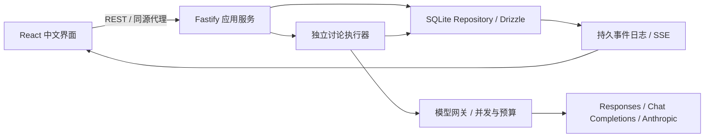
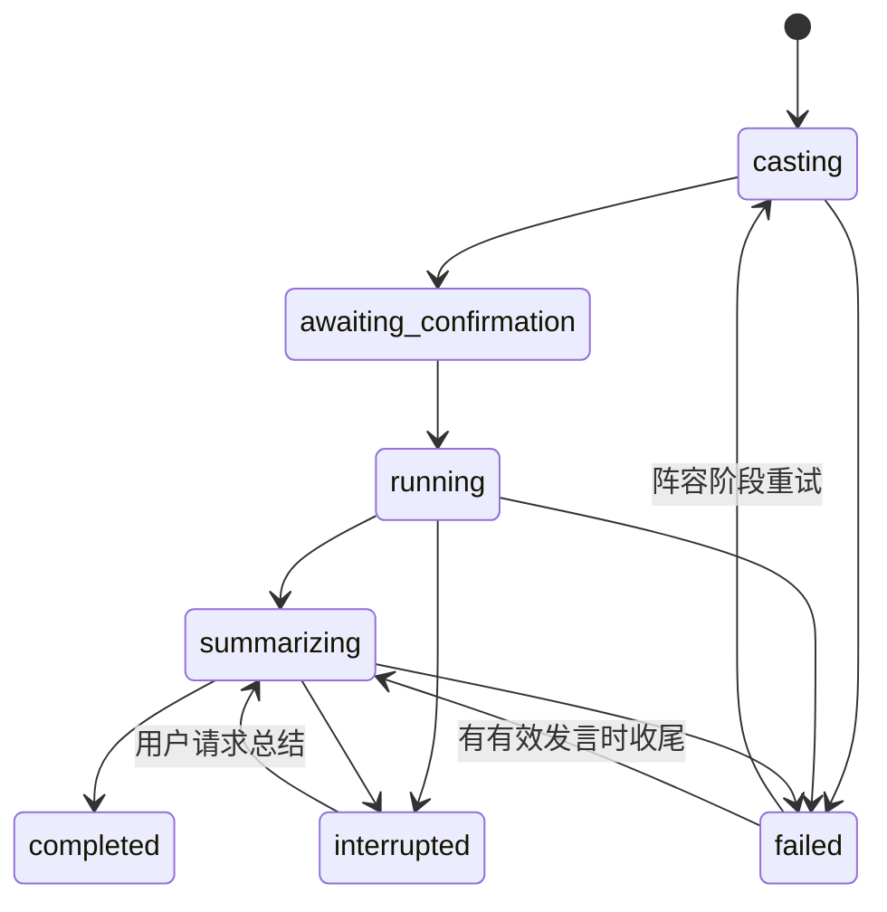

# 架构与生命周期

version 用于控制命令的乐观锁，只在生命周期与阵容绑定变更时增加；eventSeq 对全部公开变化排序，messageSeq 只对正式消息排序。generation 在启动/重试/收尾时更新，所有模型结果提交时校验 generation 与允许状态。冻结的模型配置版本不会受后续编辑影响。

网络调用不得占用数据库事务。模型返回后，在短事务内验证状态、写入消息/洞察和事件。快照在同一读取事务内取得 lastEventSeq。事件源为数据库，内存通知仅用于唤醒。客户端游标去重，缺口时获取完整快照。
