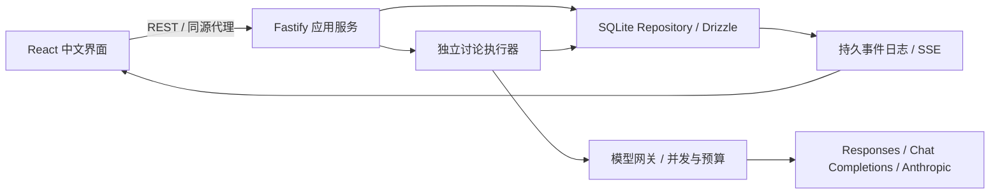
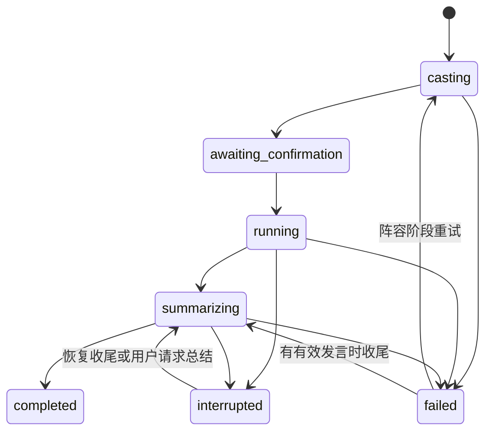

# 架构与生命周期

version 用于控制命令的乐观锁，只在生命周期与阵容绑定变更时增加；eventSeq 对全部公开变化排序，messageSeq 只对正式消息排序。generation 在启动/重试/收尾时更新，所有模型结果提交时校验 generation 与允许状态。冻结的模型配置版本不会受后续编辑影响。

网络调用不得占用数据库事务。模型返回后，在短事务内验证状态、写入消息/洞察和事件。快照在同一读取事务内取得 lastEventSeq。事件源为数据库，内存通知仅用于唤醒。客户端游标去重，缺口时获取完整快照。

流式发言经过供应商 SSE → 协议解析 → 公开正文字段投影 → 持久草稿/事件 → 浏览器 SSE 投影。专家只投影顶层 sentences 字符串数组，主持人只投影顶层 content；忽略 reasoning/thinking 和未知嵌套内容。流必须收到协议结束标记，随后完整 JSON、Schema 与业务校验通过才提交正式消息。草稿以累计全文替换，常规更新最多每100毫秒一次，重试重置立即发布；沿用同一 turnId 使正式提交原子替换草稿。首版不自动恢复进程重启前的模型流。

收尾由持久closing_jobs驱动：等待或限时取消后台洞察 → 至多一次最终洞察 → 有限总结候选尝试 → 必要时本地整理。每个总结请求关闭网关内部重试，由收尾层统一计数，网络、超时及非法输出可进入下一次候选；鉴权/配置错误跳过同一连接。一次收尾只提交一条总结，草稿重试重置；来源及两种覆盖范围随总结发布。重启会清除旧草稿、提高generation，按最多3场并发恢复尚未完成的收尾，保留绝对期限和尝试计数。取消/过期/数据库异常不会转为本地成功。
