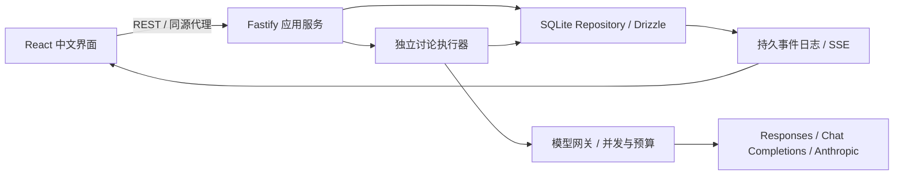
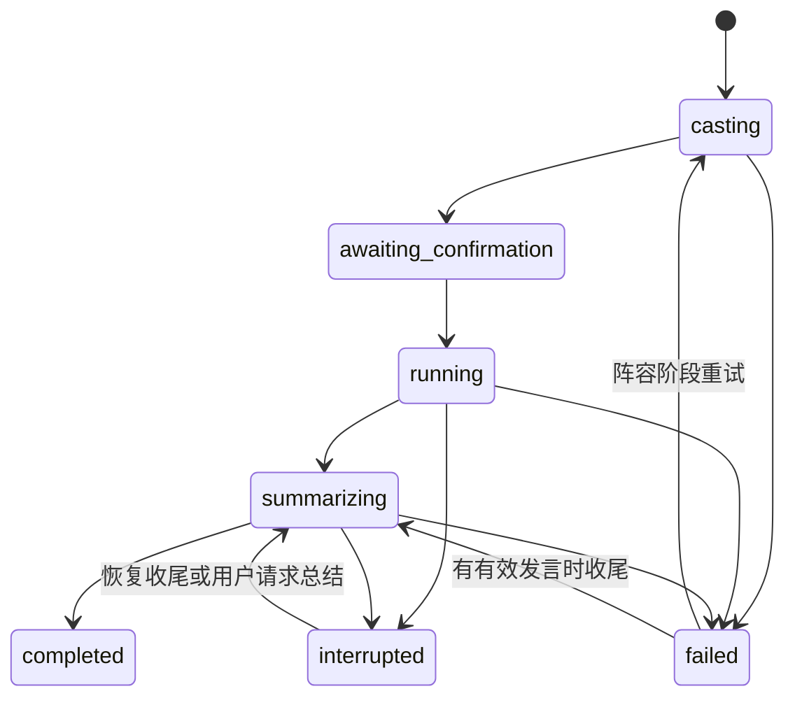

# 架构与生命周期

Vite通过`server-security.ts`限制客户端文件访问，`server.fs.allow`只列出前端、共享契约源码、共享领域源码和依赖目录。开发服务与预览服务的前置中间件在路径解码后检查私有目录、敏感扩展名和`/@fs/`路径，结合真实文件路径检查阻止链接跳出白名单；模块加载钩子再检查实际文件，Vite虚拟模块保持可用。`.env`、`.data`、`.tmp`、`.git`、后端源码、数据库及密钥不属于浏览器文件资源；`/api`继续由同源代理转交Fastify。

前端外壳占满视口并禁止文档滚动，四类页面在剩余高度内分配可滚动容器。首页讨论列表、模型列表与偏好区、阵容列表分别滚动；演播厅三个面板各自维护滚动位置。1100px及以下通过具备ARIA关联和方向键／Home／End操作的页签切换单一面板；更宽时恢复三栏。1500px及以上专家栏宽度为`clamp(270px, 15vw, 380px)`、洞察栏为`clamp(340px, 19vw, 460px)`，现场占剩余空间，消息卡片居中且最大56rem。标题和操作区在短视口下可独立滚动，避免挤出主要内容。

version 用于控制命令的乐观锁，只在生命周期与阵容绑定变更时增加；eventSeq 对全部公开变化排序，messageSeq 只对正式消息排序。generation 在启动/重试/收尾时更新，所有模型结果提交时校验 generation 与允许状态。冻结的模型配置版本不会受后续编辑影响。

网络调用不得占用数据库事务。模型返回后，在短事务内验证状态、写入消息/洞察和事件。快照在同一读取事务内取得 lastEventSeq。事件源为数据库，内存通知仅用于唤醒。客户端游标去重，缺口时获取完整快照。

流式发言经过供应商 SSE → 协议解析 → 公开正文字段投影 → 持久草稿/事件 → 浏览器 SSE 投影。专家只投影顶层 sentences 字符串数组，主持人只投影顶层 content；忽略 reasoning/thinking 和未知嵌套内容。流必须收到协议结束标记，随后完整 JSON、Schema 与业务校验通过才提交正式消息。草稿以累计全文替换，常规更新最多每100毫秒一次，重试重置立即发布；沿用同一 turnId 使正式提交原子替换草稿。首版不自动恢复进程重启前的模型流。

总结正文额外经过共享`summary-prose`边界。模型外层JSON协议保持严格；`extractSummaryProse`只接受自然语言或有界的单公开字段`content`/`summary`及字符串包装，不遍历未知对象字段、不把数组序列化为正文。网关在完整解析后规范化总结，Repository在最终提交时再次校验并保存规范文本；无效正文进入现有有限收尾尝试。`projectSummaryProse`对累计草稿暂缓未闭合包装、潜在JSON键和结构片段，普通安全正文继续流式发布；前端对总结草稿使用同一投影作为显示边界，完整输出仍须最终校验。

本地摘要保留发言归属及证据范围，对主题、角色标签、发言和洞察中无法安全摘录的结构化文本使用可追溯提示，不将其原始结构混入总结。旧历史总结只在阅读层处理：可识别包装剥离为正文，否则以该总结之前的同场正式消息重建本地摘要，显示格式异常及原记录未修改的说明。原消息、summaryMeta和模型来源持久记录不改写，显示层使用本地来源并按实际范围提供证据跳转。

参与者公开状态与调用生命周期对应。执行器在发起每位专家的意愿判断前写入preparing，并保留所有专家使用同一throughMessageSeq的上下文边界；有效候选等待仲裁时继续preparing，放弃、无效及未获选者回idle。发言排队和等待正文期间保持preparing；Repository收到非空白草稿正文时才原子写入speaking，修复或重试清空正文时回preparing。草稿清除、正式提交、取消、失败和重启恢复均清理过期状态，generation校验防止迟到结果重写新任务。

公开关注点由`buildParticipantFocus`从本场已保存角色的短专业标签、当前正式发言范围和已校验的回应目标序号构造，不复制发言正文、意愿`proposedFocus`或上游隐藏推理。`proposedFocus`仍可用于内部仲裁与发言请求，但不进入公开状态事件。状态和对应草稿/消息在同一事务中落库后推送，快照和事件流可恢复相同状态。前端每卡呈现状态和关注点，专家席以单个聚合aria-live区域播报状态摘要，不随每个正文片段朗读卡片。

收尾由持久closing_jobs驱动：等待或限时取消后台洞察 → 至多一次最终洞察 → 有限总结候选尝试 → 必要时本地整理。每个总结请求关闭网关内部重试，由收尾层统一计数，网络、超时及非法输出可进入下一次候选；鉴权/配置错误跳过同一连接。一次收尾只提交一条总结，草稿重试重置；来源及两种覆盖范围随总结发布。重启会清除旧草稿、提高generation，按最多3场并发恢复尚未完成的收尾，保留绝对期限和尝试计数。取消/过期/数据库异常不会转为本地成功。
