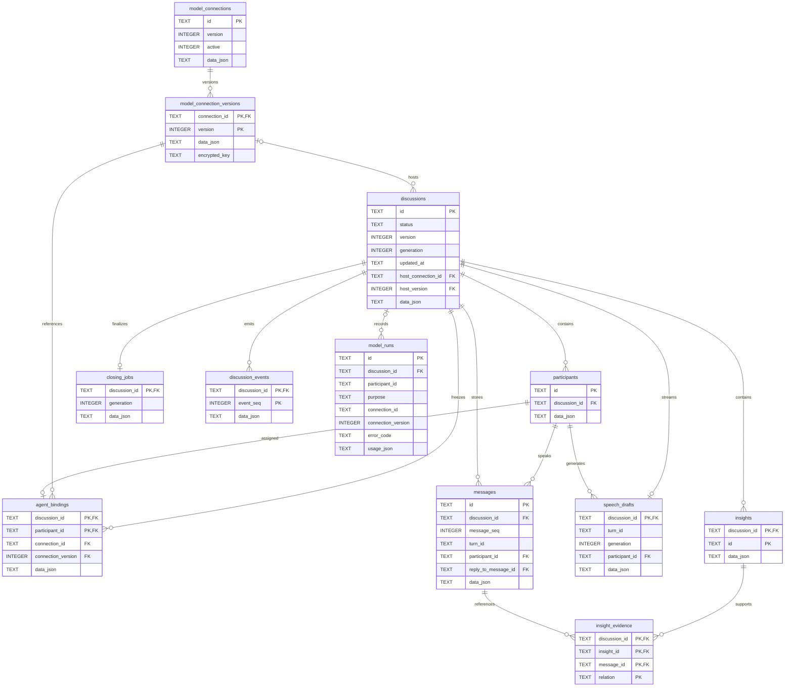

# 数据模型

下图列出核心物理外键；标为PK的多字段共同组成复合主键。`data_json`保存经共享Schema校验的业务快照，排序、外键和并发控制需要的字段独立成列。完整DDL以 `db/migrations/001.sql` 至 `003.sql` 为准。

`command_receipts(scope,idempotency_key)`是独立复合主键表，没有discussion外键，按应用定义的scope关联命令，保存请求fingerprint与结果；创建回执在删除讨论后保留删除标记。`settings(key,value)`保存默认主持人，`schema_migrations(version,applied_at)`记录初始化版本。`model_runs.participant_id`及连接字段记录审计归属，当前DDL未为其建立外键；因此不在图中冒记数据库约束。

| 不变量                       | 实现位置                                                                        |
| ---------------------------- | ------------------------------------------------------------------------------- |
| 本场正式序号与turn唯一       | `messages` 的 `(discussion_id,message_seq)`、`(discussion_id,turn_id)` 唯一约束 |
| 回应目标、角色、证据不得跨场 | 复合外键与Repository事务内校验                                                  |
| 讨论命令防重复、防旧版本覆盖 | `command_receipts` 与 `expectedVersion/castVersion`                             |
| 迟到模型结果不得回写         | 提交前检查 `generation` 和当前允许状态                                          |
| 快照与SSE具有一致边界        | 同一读取事务取得快照及lastEventSeq；事件入库后才通知                            |
| 局部共识不得升级为全体       | `validateInsightEvidence` 按支持发言及专家集合校验，沉默不计入                  |

每个讨论内 message_seq、turn_id、event_seq 唯一。角色、回应目标和洞察证据的归属在事务内校验。SQLite 开启 WAL、foreign_keys 与 busy_timeout。模型及明文凭据从被 Git 忽略的根目录 .env 加载；同步到数据库的历史凭据采用 AES-256-GCM 加密，主密钥和数据库存入被 Git 忽略的 .data。公开连接类型只返回 hasApiKey，不返回密文或明文凭据。

环境模型使用 `env:<模型标识>` 作为稳定连接 ID。启动同步在同一事务中执行：新条目创建、变化条目新增版本、未变化条目保留版本与测试状态、不再列出的条目停用。历史连接版本保留，既有讨论的冻结绑定不重写；默认主持人优先采用显式环境选择，否则保留仍有效的网页选择，再回退到清单首项。

迁移 `002.sql` 新增 `speech_drafts`：每场至多一个草稿，保存 turn_id、generation、participant_id 和公开正文；复合外键约束参与者属于当前讨论。草稿更新与 `speech.updated` 事件同事务保存，完整发言与 `message.committed` 事件提交时同事务删除相同 turn_id 草稿。清理产生 `speech.cleared`，状态切换和重启恢复也会清理。草稿没有 message_seq，不进入 transcript、上下文或洞察证据。

迁移 `003.sql` 新增 `closing_jobs`：保存generation、绝对deadlineAt、已使用尝试数、最大次数、主持人优先的冻结候选版本、最终洞察是否已尝试和失败连接。一次网络请求之前原子认领次数，进程重启后未完成请求仍计入额度；恢复只更换generation，不延后期限或清零次数。总结成功时与消息/完成事件一起删除任务。明确的手动重试可以创建新的收尾任务。

新总结的summaryMeta单独保存全文覆盖序号与真实洞察覆盖序号。模型来源须匹配本场冻结绑定；本地来源不能声明模型或连接。洞察进度落后时也允许提交有完整发言覆盖声明的总结，原insightsThrough不被修改。旧JSON历史不强制补写来源。
