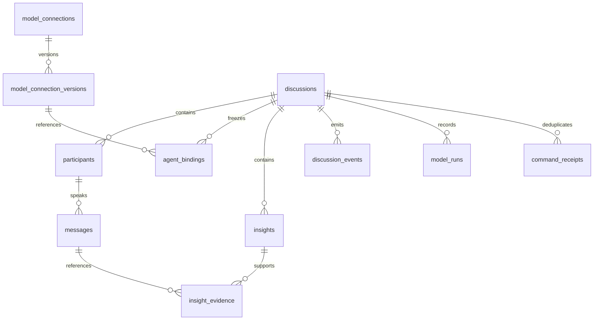

# 数据模型

每个讨论内 message_seq、turn_id、event_seq 唯一。角色、回应目标和洞察证据的归属在事务内校验。SQLite 开启 WAL、foreign_keys 与 busy_timeout。模型及明文凭据从被 Git 忽略的根目录 .env 加载；同步到数据库的历史凭据采用 AES-256-GCM 加密，主密钥和数据库存入被 Git 忽略的 .data。公开连接类型只返回 hasApiKey，不返回密文或明文凭据。

环境模型使用 `env:<模型标识>` 作为稳定连接 ID。启动同步在同一事务中执行：新条目创建、变化条目新增版本、未变化条目保留版本与测试状态、不再列出的条目停用。历史连接版本保留，既有讨论的冻结绑定不重写；默认主持人优先采用显式环境选择，否则保留仍有效的网页选择，再回退到清单首项。
