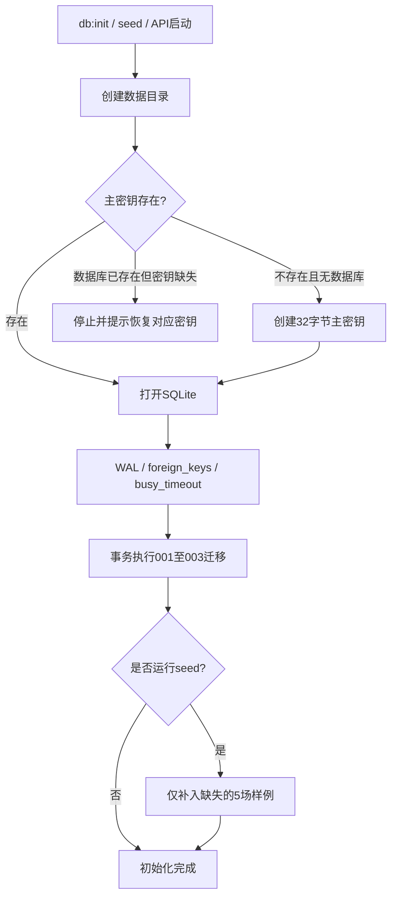

# 数据库初始化与样例导入

## 从空目录建立数据库

在仓库根目录执行 `pnpm install --frozen-lockfile`，然后执行：

```sh
pnpm db:init
pnpm seed
```

PowerShell环境也可用 `.\scripts\tool.ps1 db:init` 和 `.\scripts\tool.ps1 seed`。初始化入口是 `apps/api/src/init-db.ts`，样例入口是 `apps/api/src/seed.ts`。两者均调用同一Repository初始化逻辑；API启动时也会执行该逻辑，不依赖人工运行数据库管理工具。

默认生成 `.data/panel.sqlite` 和 `.data/master.key`。`.env`中的 `DATA_DIR` 可改为绝对目录；数据库与密钥始终位于同一数据目录。初始化不会发起模型请求，也不会把真实模型写进演示数据。

## 迁移脚本

| 文件                    | 内容                                                         |
| ----------------------- | ------------------------------------------------------------ |
| `db/migrations/001.sql` | 基础业务表、连接版本、消息与事件唯一约束、复合外键、迁移记录 |
| `db/migrations/002.sql` | 每场唯一的公开流式草稿                                       |
| `db/migrations/003.sql` | 可恢复收尾任务、尝试次数与总期限                             |

Repository在一个同步事务中依次执行当前三个幂等SQL脚本，`schema_migrations`记录版本。当前机制是重复执行幂等建表脚本，不是通用的增量迁移框架；未来新增非幂等ALTER时应先根据版本表判定执行。不要只用sqlite命令创建库而遗漏主密钥初始化。



## 5场样例与幂等行为

可执行来源为 `packages/domain/src/samples.ts`，可读全文见[样例文档](samples.md)。ID固定为 `sample-1` 至 `sample-5`，每场5位虚构嘉宾、6条消息、3类洞察，不绑定API连接，`isSample=true`。再次执行seed不会覆盖已有同ID记录，不会复制样例或修改真实讨论。既有数据库不会因样例文案更新而自动改写；在新的数据目录可看到最新样例。

`pnpm verify:clean` 在隔离目录连续执行初始化和两次seed，再通过API检查恰好5场样例、无模型连接和完整快照。该流程使用空白环境模板，无需真实密钥。

## 持久化、备份与恢复

发言、摘要、角色、洞察、事件和调用记录保存在SQLite；浏览器缓存不是历史的唯一来源。写入正式消息和对应事件处于同一事务。草稿可刷新恢复，但不会作为正式证据。

本地备份时先停止应用，使数据库连接关闭，再整体复制数据目录并妥善保存后端 `.env`；历史连接解密依赖同目录的主密钥。恢复时使用相互匹配的数据库与密钥，不能用新生成的master.key替换旧密钥。正在运行时不要只复制WAL模式的主数据库文件。

启动恢复会保留已提交内容、清理旧草稿与状态；运行中的讨论标记中断，已进入收尾的任务按原期限和次数恢复。数据目录、真实环境和备份不进入源码仓库。
