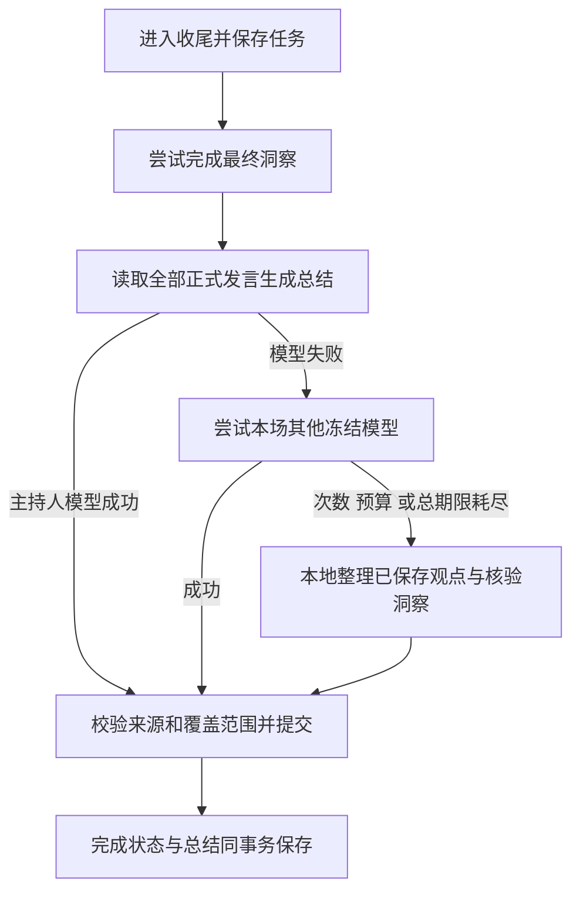

# 总结可靠性机制

本机制作用于每一场讨论，包括正常结束、提前结束、专家模型连续失败和服务重启后的收尾恢复。

最终洞察失败不再成为总结的前置阻塞。模型收到完整正式发言、已有核验洞察及其覆盖进度；界面在洞察落后时明确提示。洞察不完整时不能声称全体共识已完成核验，insightsThrough始终保留真实进度。

候选模型仅来自本场开始时已经冻结的角色绑定，主持人优先，然后按专家顺序去重。修改.env不会把新凭据或新模型替换进旧讨论。默认总结最多4次网络请求，修复非法输出也算一次；只有一个候选时可有限重试，鉴权/请求配置错误的候选在本次收尾中跳过。最终洞察最多追加1次请求，总调用量仍受原讨论预算约束。

收尾总期限默认6分钟，包含等待后台洞察、最终洞察、排队和各次总结。模型调用同时受其独立期限限制。总期限、调用预算或尝试次数用尽时，系统停止请求模型，生成明确标注的本地整理摘要。

本地摘要列出主题、主持问题、每位专家的逐条观点摘录、已有核验共识、分歧与待解问题。摘录带真实发言序号并可在界面跳转；长内容标为节选。草稿、旧总结、跨场内容不会进入摘要。没有共识证据时写明尚无已核验共识；尚未发言者不作为支持者。该输出是对保存记录的整理，不冒充模型推理。

收尾任务在请求之前持久化尝试数和绝对期限。服务重启后恢复原收尾，最多与其他讨论合计3场并行；已消耗的次数和等待时间不会因重启归零。运行中专家讨论保持中断，用户可以请求收尾，首版不自动续跑专家轮次。已完成讨论不重复总结。

总结消息的summaryMeta记录实际来源、模型连接版本、完整发言覆盖序号和洞察实际覆盖序号。消息、草稿删除、任务删除、完成状态及公开事件一起提交。数据库读写失败、用户取消和过期执行结果不会被标为成功，历史有效内容继续保留。

可调整环境变量：

| 配置                            | 默认值 | 用途                   |
| ------------------------------- | ------ | ---------------------- |
| INSIGHTS_TIMEOUT_MS             | 180000 | 单次洞察期限，毫秒     |
| INSIGHTS_MAX_TOKENS             | 8192   | 洞察输出上限           |
| SUMMARY_TIMEOUT_MS              | 240000 | 单次模型总结期限，毫秒 |
| SUMMARY_MAX_TOKENS              | 8192   | 模型总结输出上限       |
| FINALIZATION_TIMEOUT_MS         | 360000 | 整个收尾的总期限，毫秒 |
| FINALIZATION_MAX_MODEL_ATTEMPTS | 4      | 总结网络请求次数上限   |
